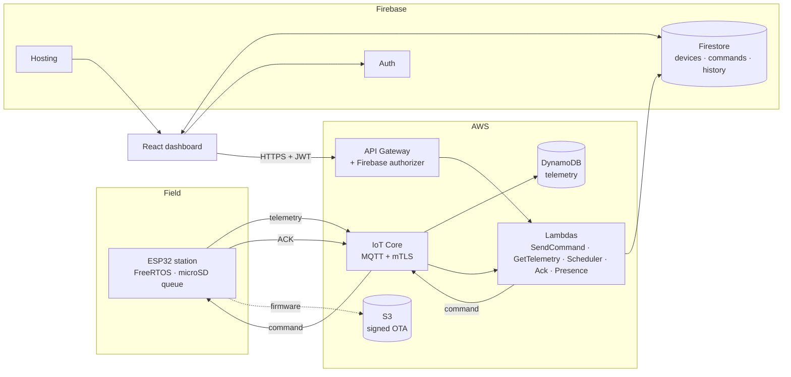

# AgroSmart V5 — Precision Irrigation IoT

**End-to-end smart irrigation system**: an ESP32 field station, AWS IoT and serverless back end, Firebase, and a React dashboard — built with a security-first mindset.

**Live project page:** https://agrosmart-v5.web.app/sobre · 🇧🇷 [Leia em português](README.pt-BR.md)

> Academic and portfolio project (started as my Systems Analysis and Development capstone). Not affiliated with the company Agrosmart.

## What it does
- Monitors air temperature, air humidity, soil moisture, light, UV and rain in real time.
- Opens and closes an irrigation valve from the web, from weekly schedules, or from physical buttons on the station.
- Skips irrigation when rain is forecast (Open-Meteo, 3-hour window).
- Keeps a full audit trail: every command is confirmed by the station itself (ACK) and logged.
- Lets recruiters operate the real station with a temporary, revocable guest pass.

## Architecture


## Engineering highlights
| Area | What was done |
|---|---|
| Command safety | Every command carries a unique `command_id`; the station deduplicates it (idempotency), so a retry never opens the valve twice |
| Offline resilience | Telemetry is queued on microSD (write-ahead log) during outages and replayed in order; a 7-minute network loss was tested with zero lost readings |
| Physical safety | Maximum valve-open time, safe OFF state on reboot, brownout or lost connection; stale commands are rejected after reconnection |
| Firmware updates | OTA images are signed (ECDSA P-256) and verified before download and before flashing, with automatic rollback |
| Access control | Device ownership checked on the server for every route (no IDOR); Firestore rules tested with 51 emulator tests; guest passes expire and can be revoked |
| Device identity | One X.509 certificate per station, MQTT over mutual TLS, per-thing policies |
| Web app | React + TypeScript, lazy-loaded pages with a size budget, dark mode, accessible dialogs, keyboard shortcuts, mobile layout, 270 automated tests |

## Measured results
| Metric | Value |
|---|---|
| Click → valve open → confirmation | ≈ 1.2 s |
| Valve switching at the pin | ≈ 44 ms |
| Signed OTA (1.15 MB) | ≈ 58 s |
| Web app initial load (gzip) | ≈ 276 KB |
| Security tests | 12/12 MQTT injection attempts rejected · 3/3 OTA tampering attempts rejected |

## Repository layout
```
apps/web/            React dashboard (Vite, TanStack Query, Zod, ECharts, Tailwind)
firmware/station/    ESP32 firmware (PlatformIO, Arduino, FreeRTOS)
cloud/aws/lambdas/   AWS Lambda functions (Python) and the Firebase authorizer (Node.js)
cloud/firebase/      Firestore security rules
```
Secrets, certificates, account IDs and endpoints are **not** in this repository. Configuration values are placeholders.

## Run the web tests
```bash
cd apps/web
npm ci
npm test
npm run build
```

## How AI was used
AI assistants generated a large part of the code. I defined the requirements and architecture, reviewed every change, ran the tests on real hardware and cloud resources, audited security, and made the decisions. This repository is published by an automated exporter that blocks secrets and personal data before anything leaves my private repository.

## Roadmap
- **Now:** field installation in the garden.
- **Next:** hourly/daily aggregates for long-range charts; enforced App Check.
- **Future (V6):** new architecture with more local autonomy, data engineering (bronze/silver/gold) and BI dashboards.

## Author
**James Rafael Ehlert Reinard** — [LinkedIn](https://www.linkedin.com/in/james-ehlert-reinard/) · [GitHub](https://github.com/JamesEhlert)

Copyright © 2026 James Rafael Ehlert Reinard. All rights reserved. See [LICENSE](LICENSE).
