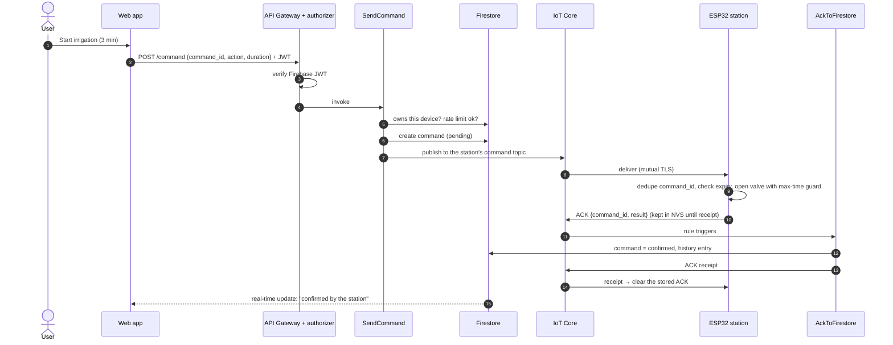
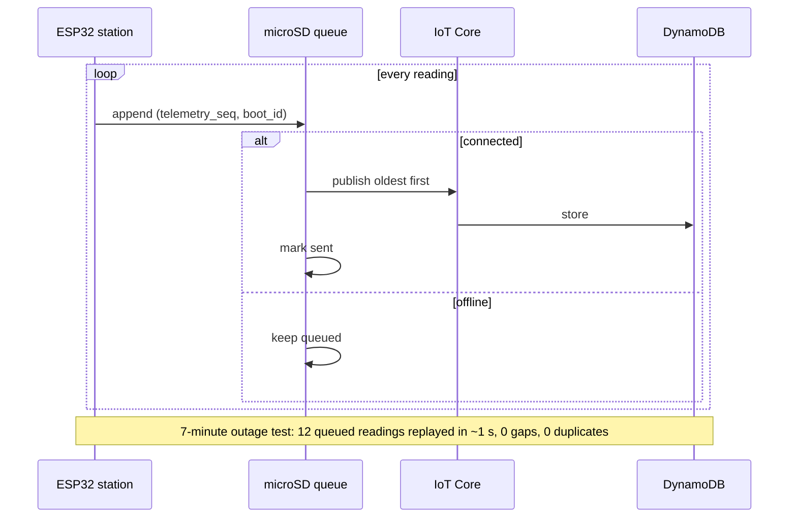
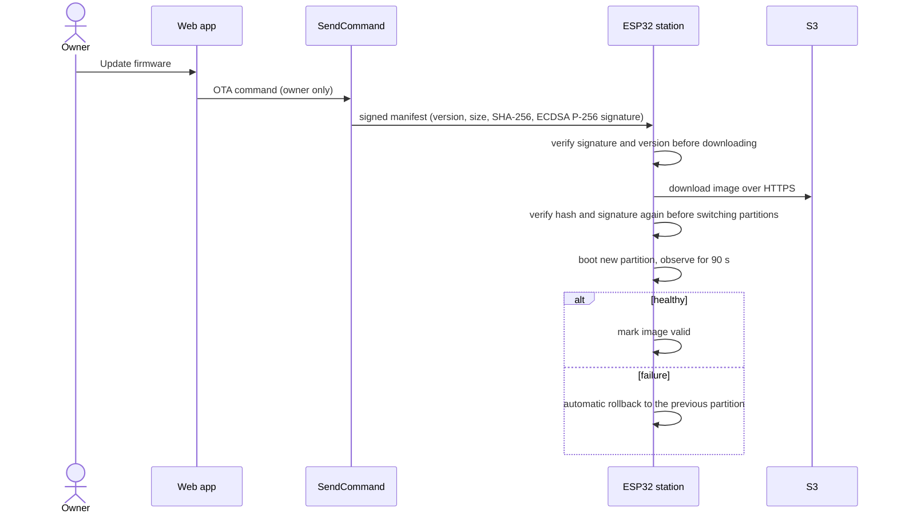

# Architecture

AgroSmart V5 connects one ESP32 field station to two clouds: **AWS** handles device traffic (MQTT, telemetry, commands, firmware) and **Firebase** handles people (login, real-time state, audit history, hosting). Each cloud does what it is best at, and the web app talks to both.

## Components
| Component | Responsibility |
|---|---|
| ESP32 station (FreeRTOS) | Reads 6 sensors, drives the valve relay, keeps a write-ahead queue on microSD, stores pending ACKs in NVS, handles physical buttons and the OLED display |
| AWS IoT Core | MQTT over mutual TLS, one X.509 certificate and policy per station, rules that route messages to DynamoDB and Lambda |
| API Gateway + Firebase authorizer | Validates the user's Firebase JWT (RS256, JWKS) before any Lambda runs |
| `SendCommand` | Checks device ownership and rate limits, records the command, publishes it to the station |
| `AckToFirestore` | Applies the station's confirmation to the command and the audit history, then sends an ACK receipt back |
| `GetTelemetry` | Returns readings (latest or downsampled ranges) after checking device ownership |
| `Scheduler_Logic` | Runs weekly schedules in the cloud, skips irrigation when rain is forecast, flags commands the station never confirmed |
| `PresenceToFirestore` | Turns MQTT connect/disconnect events into online/offline status |
| DynamoDB | Time series of readings |
| Firestore | Devices, commands, audit history, schedules, presence; protected by security rules tested in the emulator |
| S3 | Signed firmware images for OTA |

## 1. A manual command (click → valve → confirmation, ≈ 1.2 s)

## 2. Telemetry that survives a network outage

## 3. Signed firmware update (OTA)

## Design decisions
See [adr/](adr/) for the reasoning behind the main choices.
